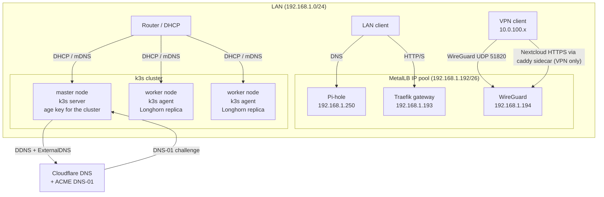
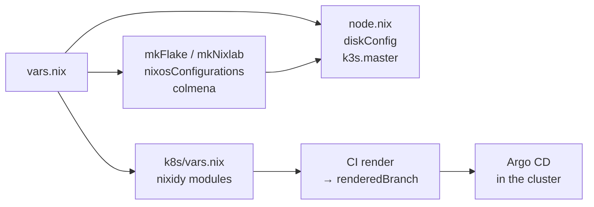

# Architecture

## Cluster topology

nixlab runs a [k3s](https://k3s.io/) cluster where nodes are divided into masters (one, or three for high availability) and any number of workers. Masters run the k3s server and etcd, and give the cluster the age key that decrypts its secrets; Kubernetes schedules workloads across all nodes. Workers run k3s agent and contribute CPU, RAM, and disk (via Longhorn) to the cluster. Workloads are deployed by Argo CD from manifests that CI renders into a branch of your repo.



## nixlab and your repo

nixlab is a library flake. Your homelab is a separate, small repo (made with `nix flake init -t github:thatbagu/nixlab`) whose `flake.nix` is one call:

```nix
inputs.nixlab.url = "github:thatbagu/nixlab";
outputs = { nixlab, ... }: nixlab.lib.mkFlake { src = ./.; };
```

`mkFlake` reads `vars.nix`, `secrets.yaml`, `hosts/<hostname>/hardware-configuration.nix` and `apps/` from your repo and returns the whole flake: `nixosConfigurations`, the Colmena hive, the Kubernetes render (`nixidyEnvs`), the `nix run` tools and checks. Extension points, all in your `flake.nix`: `extraNixosModules` (NixOS on every node), `extraAppModules` (more apps, or overrides of nixlab's), `extraSecrets` (Kubernetes Secrets for your apps). Upgrading nixlab is `nix flake update nixlab`; nothing of nixlab's is copied into your repo, so there's nothing to merge.

Inside nixlab (`lib.mkNixlab`, `system/mk-nixlab.nix`), your vars reach every part as an argument, never by importing a file:

## How vars.nix flows through the system

1. **`mkNixlab`** reads `vars.nodes` to build `nixosConfigurations` and the [Colmena](https://colmena.cli.rs/) hive. Each node becomes one configuration, using `node.hostname` as the NixOS hostname and `node.tags` as Colmena tags for targeted deploys.

2. **`system/node.nix`** looks up `vars.nodes.${hostname}` to set `diskConfig.device`, `diskConfig.espSize`, and the `master` flag for k3s.

3. **`system/k8s/vars.nix`** derives the Kubernetes-side settings (namespaces, IP pools, TLS issuers, `gitRepository`, which built-in apps are on) from it. Every [nixidy](https://nixidy.dev) module reads those. CI renders the nixidy environment (`.#homelab`) into `renderedBranch`, which Argo CD syncs.



Nothing else needs to be edited to configure the cluster. `vars.nix` is the single source of truth.

## Disk layout and impermanence

Each node's disk is partitioned with [Disko](https://github.com/nix-community/disko):

```
/dev/sdX (GPT)
├── boot   (1 MiB, BIOS boot)
├── ESP    (500 MiB, vfat, /boot)
└── root   (remainder, LVM PV)
    └── root_vg / root (LVM LV)
        └── btrfs
            ├── subvol /root     → /          (wiped on every boot)
            ├── subvol /persist  → /persist   (survives reboots)
            └── subvol /nix      → /nix       (Nix store, survives reboots)
```

During early boot, a systemd initrd service (`rollback`) runs before `/` is mounted:

1. Mounts the raw btrfs volume.
2. Renames the current `/root` subvolume to `/old_roots/<timestamp>`.
3. Creates a fresh empty `/root` subvolume.
4. Deletes `old_roots` entries older than 30 days.
5. Unmounts and lets the normal boot continue.

The result: every boot starts from a clean slate. Files written to `/` during a session vanish on the next reboot.

### What persists

The [impermanence](https://github.com/nix-community/impermanence) module (`system/impermanence/default.nix`) bind-mounts selected paths from `/persist` into the fresh `/`:

**System state:**
- `/etc/nixos`, `/var/log`, `/var/lib/nixos` - NixOS metadata
- `/etc/NetworkManager/system-connections`, `/var/lib/NetworkManager` - network config
- `/var/lib/kubelet`, `/var/lib/rancher/k3s`, `/etc/rancher` - k3s state
- `/var/lib/longhorn`, `/var/lib/csi`, `/var/lib/docker` - storage
- `/etc/machine-id`, `/etc/adjtime` - stable machine identity

**SSH host keys** live at `/persist/etc/ssh/ssh_host_ed25519_key` and `ssh_host_rsa_key`. The `openssh` service is configured to use those paths so host key fingerprints don't change across reboots.

**User home directories:** `~/Code`, `~/Documents`, `~/.ssh`, `~/.gnupg`, `~/.config`, `~/.local` and `~/.config/sops` are persisted per-user.

**SOPS age key:** `/persist/etc/sops-nix/keys.txt` - the [age](https://github.com/FiloSottile/age) private key used to decrypt `secrets.yaml`.

## k3s module

`system/k3s/default.nix` configures k3s based on `node.master`:

- **Master** (`master = true`): runs as `server` with `--cluster-init`, `--disable=servicelb`, `--disable=traefik`, `--disable=local-storage`. Writes the admin kubeconfig to `/etc/rancher/k3s/k3s.yaml` with mode `0640`, group `wheel`: your user can run `kubectl` without sudo, other local users and services can't (a world-readable admin kubeconfig is cluster-admin for anything on the box).
- **Agent** (`master = false`): runs as `agent` and derives the master's URL from `vars.nodes` at build time - `serverAddr = "https://${masterHostname}:6443"`. No manual IP configuration needed.

Both roles use `config.sops.secrets.k3s_token.path` as the token file and run `openiscsi` (required by Longhorn).

The NixOS firewall is **on** and allows only what the cluster needs from the LAN: SSH (22), the Kubernetes API (6443), the kubelet (10250), MetalLB memberlist (7946 TCP/UDP), flannel VXLAN (8472/UDP) and the NodePort range. `cni0` and `flannel.1` are trusted (pod-to-host traffic) and reverse-path filtering is loose. LoadBalancer/NodePort traffic is DNATed to pods before the input chain, so services aren't affected. etcd (2379/2380) stays closed: with a single server it is only used locally.

SSH is **keys-only** (`PasswordAuthentication = false`, `PermitRootLogin = "no"`): the cluster user has passwordless sudo, so a password login would make a guessed or phished password root on the cluster.

## Kubernetes deployment (GitOps)

Kubernetes resources are described in Nix with [nixidy](https://nixidy.dev) and
deployed by [Argo CD](https://argo-cd.readthedocs.io/):

1. Each file under `system/k8s/services/` (the platform) and `apps/`
   (your apps, picked up automatically) is a nixidy module that
   defines one or more `applications.<name>`: Helm charts via
   `helm.releases` (charts pinned in `system/k8s/charts/` and your `charts/`),
   plain resources via `yamls = map builtins.toJSON [ ... ]`. Both are checked
   against the Kubernetes schemas at render time.
2. On every push to `main` that touches them, the **Render k8s manifests**
   workflow builds `.#homelab` and commits the YAML to `renderedBranch`
   (`apps/` holds the Argo CD Applications, every other directory is one app).
3. (With `gitops.enable = false` there's no Argo CD: the master hands every app's manifests to k3s' auto-deploy directory instead.)
   Argo CD (itself an app, `argocd`) syncs everything from that branch through
   an app-of-apps (`apps`). On a fresh cluster the master's `argocd-bootstrap`
   unit installs Argo CD and that parent app once, from the same render.

Defaults set in `system/k8s/nixidy.nix`:

- Every app **auto-syncs, self-heals and prunes**. Removing a resource from Nix
  deletes it from the cluster; manual `kubectl` edits are reverted.
- **Longhorn is manual-sync** so a bad push can't reach storage unattended (its
  chart's uninstall Job is filtered out of the render).
- **PersistentVolumeClaims, CRDs and Namespaces** carry
  `Prune=false,Delete=false`: Argo CD never deletes storage or a CRD (which
  would delete every resource of that kind).
- `syncWave` orders the apps: storage and MetalLB (0), MetalLB config (1),
  the gateway (1), Pi-hole/cert-manager (2), DNS and issuers (3), VPN and apps (4).

Secrets go through git too, still encrypted: the **`nixlab-secrets`** app
carries `secrets.yaml` as it is and a Job decrypts it in the cluster (see
[Managing Secrets](./secrets.md#how-app-secrets-reach-the-cluster)). The only
thing the host adds is the age key, once (`nixlab-age-key`).

## SOPS secrets

All secrets live in `secrets.yaml`, encrypted with [SOPS](https://github.com/getsops/sops) + age. The key file location on running nodes is `/persist/etc/sops-nix/keys.txt`. [sops-nix](https://github.com/Mic92/sops-nix) decrypts secrets at activation time.

`system/sops/default.nix` declares every secret and maps it to a file path that NixOS services can read. WireGuard user public keys are registered automatically by iterating over enabled entries in `vars.wireguardUsers` - each entry's `publicKeySecret` field becomes a SOPS secret name.

The cluster's own secrets (everything the nodes don't need) are decrypted in the cluster by the `nixlab-secrets` Job, from the encrypted `secrets.yaml` that the render carries. Decrypted values never go through git or Argo CD.

## Security model

- **Nextcloud is VPN-only.** It has no route through the gateway; `nextcloud.<domain>` resolves
  to `10.0.100.1` (the VPN proxy, unreachable without the VPN) in Pi-hole and,
  with Cloudflare, in public DNS; logins are limited to VPN addresses.
- **VPN auto-login can't be forged.** Caddy maps the client's VPN address to a
  Nextcloud user and sends `X-Remote-User` together with a shared secret
  (`nextcloud_sso_secret`); Nextcloud's `.htaccess` only honours the header when
  the secret matches. WireGuard ties every key to one VPN address, so a peer
  can't pose as another.
- **VPN peers get only what their group allows.** Non-admin peers may use
  Pi-hole DNS, the VPN proxy and their group's `allowedNetworks`; everything else
  is dropped by the WireGuard server.
- **Pi-hole has a password** (`pihole_password`) and is LAN-only.
- **The gateway ignores client-supplied `X-Forwarded-For`** (Traefik trusts
  forwarded headers from nobody), so clients can't spoof their IP; behind the
  edge proxy it takes the address from the PROXY protocol, accepted only from
  the pod network.
- **Secret files on the nodes are `0400 root`.**
