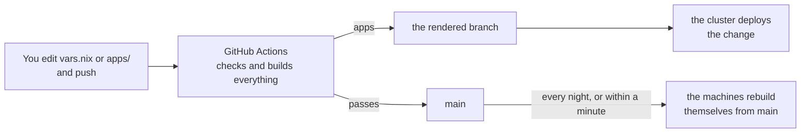

# How It Works

The short version, for running a lab. The full picture is in [Architecture](./architecture.md).

## Your repo is your lab

Everything about your lab is in one small git repository:

```
vars.nix        your machines, network, domain, users, which features are on
apps/           your own apps, one file each
hosts/          one hardware file per machine (written by the installer)
secrets.yaml    passwords and keys for the machines, encrypted
secrets/k8s/    passwords and keys for the apps, encrypted
flake.nix       says "use nixlab", and which version
```

nixlab itself isn't copied in: it's a dependency, like a library. Upgrading it is changing one version number.

## What happens when you push



- **Apps** (anything in Kubernetes) change within a few minutes of a push: CI turns your Nix into Kubernetes manifests, and Argo CD in the cluster applies them. If you change something by hand in the cluster, it's put back.
- **Machines** (the operating system) rebuild themselves from `main`: every night by default, or within a minute with continuous deploys. They go one at a time, so the lab stays up.
- **Mistakes are caught before they deploy:** a typo in `vars.nix` or a broken app fails CI, with a message saying what's wrong.

Without Kubernetes, there's only the second path: the machine rebuilds and runs your apps directly.

## Every boot starts clean

On each boot, a machine's system disk is reset to exactly what your repo says. Only the things that should last (app data, logs, keys) are kept, in `/persist`. So a machine can't slowly drift into a state nobody remembers, and rebuilding one from scratch gives you the same machine.

## What runs where

| | |
|---|---|
| **Masters** | run the cluster's control plane. One, or three so the lab survives one failing. They run apps too. |
| **Workers** | run apps and hold copies of their data. Add as many as you like. |
| **One machine** | is both, with no copies of data (back it up). |

In a cluster, every app's data is kept on three machines, so an app moves to another machine when one dies, with its data.

## How you reach things

- **Apps** are at `https://<app>.<your domain>`, each with a real certificate (or one from nixlab's own certificate authority, without Cloudflare).
- **Inside your home,** Pi-hole answers DNS for those names, and blocks ads.
- **From outside,** you connect with the WireGuard VPN, or Tailscale. Nothing is open to the internet unless you open it.

## Secrets stay encrypted

Passwords and keys are encrypted in your repo with your personal key (an age key, on your laptop). The machines and the cluster decrypt them themselves; they're never in plain text in git or CI. Keep a copy of your key somewhere safe: see [Passwords and Keys](./secrets-basics.md).
