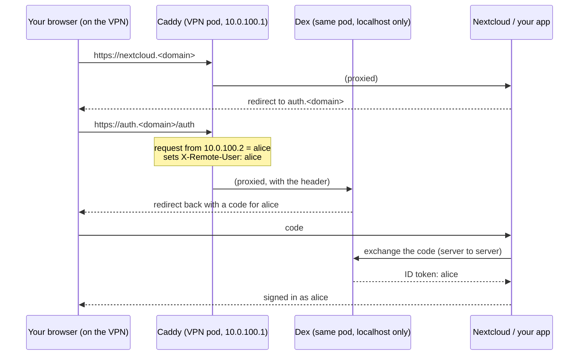

# Single Sign-On

With `sso.enable = true`, nixlab runs an OpenID Connect (OIDC) provider, [Dex](https://dexidp.io), at `https://auth.<domain>`. Over the VPN you're **signed in automatically**, with no password and no prompt, in Nextcloud and in every app you register. It's standard OIDC, so anything that supports "Log in with OpenID Connect" (Grafana, Argo CD, Immich, Paperless, …) can use it.

## How you get signed in



- **Caddy knows who you are by your VPN address:** every VPN user has a fixed address in `vars.nix`, and WireGuard's keys guarantee nobody else can use it.
- **Dex trusts only Caddy.** It listens on localhost inside the VPN pod, so nothing else in the cluster or on the network can reach it. Caddy strips `X-Remote-User` from every incoming request and sets it itself, and only for requests from a known VPN address.
- **Requests from anywhere else get no identity:** apps exchanging codes, or a peer without an entry in `wireguardUsers`. Apps reach Dex for that exchange through the cluster: `auth.<domain>` resolves to the VPN pod inside the cluster.
- **Your identity** is your `nextcloudUser`, or your VPN user name if you don't set one. Existing Nextcloud accounts keep working.

Off the VPN, `auth.<domain>` isn't reachable at all, just like Nextcloud.

## Turning it on

```nix
sso.enable = true;
```

It needs the VPN (`vpn.enable`) and certificates (`certManager.enable`), which are on by default. Run `nix run .#init` on a new setup, or add the client secret Nextcloud and Dex share to an existing one:

```bash
printf '"%s"' "$(openssl rand -hex 32)" | sops set --value-stdin secrets.yaml '["sso_nextcloud_client_secret"]'
```

Commit and push. Nextcloud switches from its older header-based VPN login to the official [user_oidc](https://github.com/nextcloud/user_oidc) app and redirects straight to Dex. For the admin account's password login, open `https://nextcloud.<domain>/login?direct=1`.

Without Cloudflare (internal CA), Nextcloud is set up to trust the internal CA for talking to Dex. Your devices need to trust it too, as for every nixlab certificate (see [Services: cert-manager](./services.md#cert-manager)).

## Signing in to your own apps

Register an app as a client:

```nix
sso = {
  enable = true;
  clients = [
    {
      id = "grafana";
      name = "Grafana";
      redirectURIs = [ "https://grafana.<domain>/login/generic_oauth" ];
      secretEnv = "GRAFANA_OIDC_SECRET";   # optional: a client secret
    }
    { id = "cli"; public = true; redirectURIs = [ "http://localhost:8000" ]; }  # no secret
  ];
};
```

Then point the app at the provider:

| Setting | Value |
|---|---|
| Issuer / discovery | `https://auth.<domain>` (`/.well-known/openid-configuration`) |
| Client ID | the `id` above |
| Scopes | `openid profile` |
| User name claim | `name` |

The app must be reachable from your browser over the VPN, and it must reach `https://auth.<domain>` from inside the cluster. That works automatically for apps in the cluster.

## Limits

- **Only VPN users can sign in.** There's no password login at Dex. That's by design: nixlab's data is VPN-only.
- **Sessions live in Dex's memory,** so when the VPN pod restarts, apps send you back to Dex once. That's invisible on the VPN, because you're signed in again automatically.
- **No groups yet:** apps see your user name, not your VPN group.
