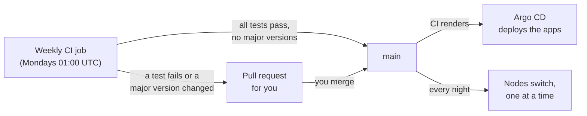

# Updates

nixlab keeps itself up to date in two steps: CI updates **the repository** once a week, and **the nodes** follow `main` every night. Both are on by default.



## The weekly update

Your repo's `.github/workflows/update.yml` runs `nix run .#update`, which:

1. updates your flake inputs: **nixlab** itself, and with it nixpkgs (NixOS, the kernel, k3s), the Helm charts (Argo CD, cert-manager, Longhorn, ...) and everything else nixlab pins. nixlab is tested before each of its own updates (its CI boots VMs of the master, Argo CD and monitoring)
2. refreshes the **digests of images pinned in your `apps/`** at their current tags. That picks up security fixes within a version; moving to a new version (tag) stays your decision

Then your manifests render and **every node builds**. If that works and no Helm chart changed its major version, the update is committed to `main` directly and Argo CD rolls the apps out. Otherwise you get a **pull request** that says why: what failed, or which charts jump a major version (read their release notes before merging).

You can run it yourself any time, e.g. before a manual deploy:

```bash
nix run .#update        # changes flake.lock and your apps' image digests
nix flake check         # renders the manifests, evaluates every node
```

To run the CI job now: Actions → **Weekly updates** → Run workflow.

### What it needs in your repository

- **Settings → Actions → General → Workflow permissions:** "Read and write permissions", and tick "Allow GitHub Actions to create and approve pull requests".
- If you protect `main` with required checks, the workflow's direct push is blocked: either allow `github-actions` to bypass the rule, or accept that every update arrives as a pull request.

## Nightly node upgrades

Every node runs NixOS' `system.autoUpgrade` against `main` of `gitRepository`: it builds its own configuration from the repo and switches to it. It runs **one node at a time**, the master first (`autoUpgrade.time`, default 03:30), then each worker `autoUpgrade.spacingMinutes` (15) later, so the cluster never loses several nodes at once.

A node **reboots only when its kernel or initrd changed**, and only inside `autoUpgrade.rebootWindow` (03:00–06:00). Longhorn keeps every volume on 3 replicas, so one node rebooting doesn't take data offline; pods on it are restarted elsewhere or when it's back.

```nix
autoUpgrade = {
  enable = true;
  time = "03:30";
  spacingMinutes = 15;
  allowReboot = true;
  rebootWindow = { lower = "03:00"; upper = "06:00"; };
};
```

Check a node: `systemctl status nixos-upgrade` and `journalctl -u nixos-upgrade`. A node that was off at its time catches up when it boots.

**The nodes must be able to read your repository.** A public repository just works. For a private one, give the nodes a read-only token: add `access-tokens = github.com=<token>` to `nix.extraOptions` through a SOPS secret, or turn `autoUpgrade.enable` off and deploy with `colmena apply` yourself.

## When an update breaks something

- **An app:** revert the update commit on `main` (`git revert <sha>` and push); Argo CD rolls back. Or roll back one app in the Argo CD UI (History and rollback).
- **A node:** the previous NixOS generation is still there. Reboot and pick it in the boot menu, or run `sudo nixos-rebuild switch --rollback`. Then revert the commit so the next nightly run doesn't upgrade it again.
- **Pause updates:** turn off the workflow (Actions → Weekly updates → Disable workflow) and/or set `autoUpgrade.enable = false` (deploy once with `colmena apply` for that to take effect).

With [monitoring](./monitoring.md) on, failing apps after an update show up as `ArgoAppDegraded`, and the standard alerts cover nodes that don't come back.
