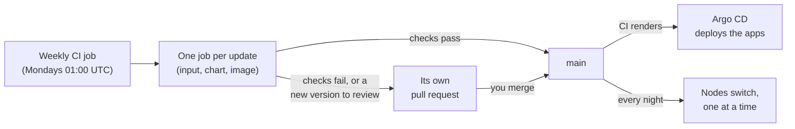

# Updates

nixlab keeps itself up to date in two steps: **the repository** gets updates as pull requests (by [Renovate](#renovate), or the [weekly update](#the-weekly-update) if you prefer), and **the nodes** follow `main` every night. Both are on by default; `nix run .#init` asks which of the two update the repository.

## Renovate

[Renovate](https://docs.renovatebot.com/) opens **one pull request per update**: nixlab itself (and with it NixOS, k3s and the platform's charts), every other flake input, the Helm charts in `charts/` and the images pinned in `apps/`. CI tests each one.

| Update | Merged by itself when CI passes? |
|---|---|
| a new digest of the same image tag (security fixes) | yes |
| a chart's or input's patch or minor version | yes |
| a new image tag, or any new major version | no: it waits for you (read the release notes) |

How, is nixlab's preset (`renovate/default.json5`), which your `renovate.json5` extends; add your own rules there. A Helm chart's new version also needs its hash in `charts/.../default.nix`: Renovate runs `nix run .#update -- fixup` on its branch for that, which is why it runs self-hosted, in your repo's `.github/workflows/renovate.yml` (daily), rather than as the Renovate app.

**It needs** a token that may open pull requests and whose pull requests run CI (the workflow's own token can't): create a [fine-grained personal access token](https://github.com/settings/personal-access-tokens/new) for your repo with *Contents*, *Pull requests*, *Workflows* and *Issues* read and write, and add it as the `RENOVATE_TOKEN` secret (Settings → Secrets and variables → Actions). The *Dependency Dashboard* issue lists every pending update.

To update by hand instead (or now): `nix run .#update` applies everything Renovate would merge by itself, `nix run .#update -- list` shows what's available. To switch to the weekly update, delete `renovate.json5` and `.github/workflows/renovate.yml` and restore `.github/workflows/update.yml` from nixlab's `template/`.


## The weekly update

The built-in alternative to Renovate, needing no token: `.github/workflows/update.yml` updates **one thing at a time**. Each of these that has an update is its own job:



| Update | Merged by itself when the checks pass? |
|---|---|
| **nixlab** (and with it NixOS, the kernel, k3s and the platform's Helm charts; nixlab tests each of those on its own before releasing) | yes |
| each other **flake input** | yes |
| each **Helm chart** in your `charts/`, to its newest release in the same major version | yes |
| a chart's **new major version** | no: a pull request, read the release notes |
| each **image pinned in your `apps/`**, at its current tag (a new build: usually security fixes) | yes |
| an image's **newer tag** (`postgres:17.11` → `18.6`) | no: a pull request, a new version is your decision |

Each job applies only its update, then your manifests render and **every node builds**. What passes is committed to `main`, one commit per update, and Argo CD rolls the apps out. Everything else gets **its own pull request**, saying why: the checks failed, or it's a new version for you to review. The pull request is rebuilt on the current `main` every week until you merge or close it.

One broken update holds up only itself: the rest still land.

You can run it yourself any time, e.g. before a manual deploy:

```bash
nixlab update list             # what has an update
nixlab update apply <id>       # one of them
nixlab update                     # all of them, except new major versions and tags
nix flake check                      # renders the manifests, evaluates every node
```

To run the CI job now: Actions → **Weekly updates** → Run workflow.

### What it needs in your repository

- **Settings → Actions → General → Workflow permissions:** "Read and write permissions", and tick "Allow GitHub Actions to create and approve pull requests".
- If you protect `main` with required checks, the workflow's direct push is blocked: either allow `github-actions` to bypass the rule, or accept that every update arrives as a pull request.
- The update logic is in nixlab (`nixlab update`), not in the workflow file, so updating nixlab also improves the updates. The workflow file only changes when nixlab's release notes say so.

## Nightly node upgrades

Every node runs NixOS' `system.autoUpgrade` against `main` of `gitRepository`: it builds its own configuration from the repo and switches to it. It runs **one node at a time**, the master first (`autoUpgrade.time`, default 03:30), then each worker `autoUpgrade.spacingMinutes` (15) later, so the cluster never loses several nodes at once.

A node **reboots only when its kernel or initrd changed**, and only inside `autoUpgrade.rebootWindow` (03:00–06:00, in the nodes' local time, `timezone`). [Backups](./backups.md) run before it by default, at 02:00 UTC; east of UTC, check the two don't overlap. Longhorn keeps every volume on 3 replicas, so one node rebooting doesn't take data offline; pods on it are restarted elsewhere or when it's back.

```nix
autoUpgrade = {
  enable = true;
  time = "03:30";
  spacingMinutes = 15;
  allowReboot = true;
  rebootWindow = { lower = "03:00"; upper = "06:00"; };
};
```

Check a node: `systemctl status nixos-upgrade` and `journalctl -u nixos-upgrade`. A node that was off at its time catches up when it boots.

**The nodes must be able to read your repository.** A public repository just works. For a private one, give the nodes a read-only token: add `access-tokens = github.com=<token>` to `nix.extraOptions` through a SOPS secret, or turn `autoUpgrade.enable` off and deploy with `colmena apply` yourself.

### Continuous deploys

With `autoUpgrade.mode = "continuous"`, the nodes don't wait for the night. Each one runs [comin](https://github.com/nlewo/comin), which checks `main` every `pollSeconds` (60) and deploys each new commit within about a minute: push a change to a node's configuration, and it's live.

```nix
autoUpgrade = {
  mode = "continuous";
  pollSeconds = 60;
};
```

- **A commit that fails to build or switch** leaves the node on its last good system, and `NixlabUpgradeFailed` fires (with monitoring on). Fix it in a new commit.
- **No reboots:** a new kernel waits until the node next reboots.
- **No staggering:** all nodes deploy within a minute of each other. For a cluster where that matters, keep `nightly`.
- **What a node deployed:** `/var/lib/nixlab/deployed` holds the commit and whether it worked. `journalctl -u comin` shows each fetch and deploy, and `comin status` shows the current state.

Kubernetes apps don't change: the GitOps controller deploys them from the rendered branch either way.

## Trying a change locally first

`nix run .#vm` starts your master as a VM on your own machine: its real configuration from your working copy, with your age key so its secrets decrypt. SSH in with `ssh -p 2222 <username>@localhost`, and the node's HTTPS is on `https://localhost:8443`. It starts clean on every run. `Ctrl-A X` quits.

Use it to check that a change to the nodes builds, boots and starts its services before you push it. With GitOps on, the VM's Kubernetes apps still come from what's pushed (the rendered branch), so it's for the node side, not app changes. For those, `nixlab render` shows exactly what will be deployed.

## nixlab's own versions

Your `flake.nix` pins nixlab to a release tag (`github:thatbagu/nixlab/v1.24.2`). Renovate and the weekly update keep that tag; moving to a newer release is your call: change the tag, then `nix flake update nixlab`. The numbers say what to expect:

| Release | What changes for you |
|---|---|
| **patch** (1.24.1 → 1.24.2) | Fixes. Nothing to do. |
| **minor** (1.23 → 1.24) | New options and features, off or harmless by default. Your `vars.nix` keeps working as it is. |
| **major** (1.x → 2.0) | Something in `vars.nix`, or a step on the cluster, needs changing. |

Every release's notes end with **Upgrading**, which says what to do, if anything. Each release is also tested against the previous one's deployed state (`vm-upgrade`), so an upgrade can't fail on objects Kubernetes won't change in place.

## When an update breaks something

- **An app:** revert the update commit on `main` (`git revert <sha>` and push); Argo CD rolls back. Or roll back one app in the Argo CD UI (History and rollback).
- **A node:** the previous NixOS generation is still there. Reboot and pick it in the boot menu, or run `sudo nixos-rebuild switch --rollback`. Then revert the commit so the next nightly run doesn't upgrade it again.
- **Pause updates:** turn off the workflow (Actions → Weekly updates → Disable workflow) and/or set `autoUpgrade.enable = false` (deploy once with `colmena apply` for that to take effect).

With [monitoring](./monitoring.md) on, failing apps after an update show up as `ArgoAppDegraded`, and the standard alerts cover nodes that don't come back.
